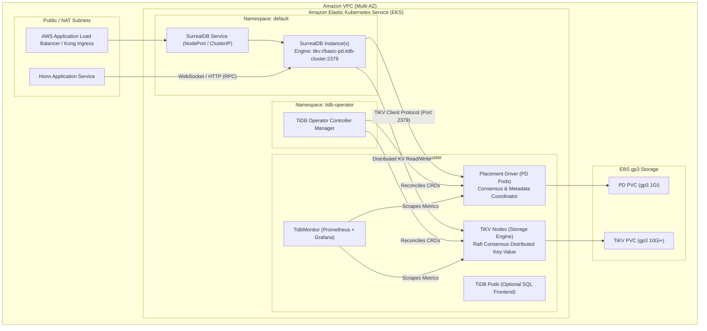

# System Architecture: SurrealDB on TiKV via AWS EKS

This document details the complete end-to-end architecture for deploying **SurrealDB** backed by a distributed **TiKV** cluster on **Amazon EKS** using **Pulumi** and **SST**.

---

## 1. High-Level Architecture Diagram



---

## 2. Component Descriptions

### 2.1 Amazon EKS Cluster
- Managed Kubernetes control plane running version 1.27+.
- Equipped with **AWS EBS CSI Driver** (`aws-ebs-csi-driver`) for dynamic provisioning of `gp3` persistent volumes.
- Provisioned across multi-AZ subnets with DNS resolution and health check ingress paths.

### 2.2 Dedicated Node Groups
To ensure optimal database performance, strict fault isolation, and eliminate noisy neighbors, node groups are partitioned with dedicated Kubernetes labels and taints:
1. **PD Node Group (`pd-nodegroup`)**:
   - Instance Type: `t4g.small` (ARM64) or `c7g.xlarge` for high throughput.
   - Taint: `dedicated=pd:NoSchedule`
   - Role: Coordinates TiKV region replication, timestamp allocation, and metadata management.
2. **TiKV Node Group (`tikv-nodegroup`)**:
   - Instance Type: `m7g.medium` (ARM64) or memory-optimized instances.
   - Taint: `dedicated=tikv:NoSchedule`
   - Role: Stores actual data partitions across Raft consensus groups with high IOPS gp3 storage.
3. **TiDB Node Group (`tidb-nodegroup`)**:
   - Instance Type: `t4g.medium`.
   - Taint: `dedicated=tidb:NoSchedule`
   - Role: Stateless SQL parsing layer (optional, for analytics and direct queries).

### 2.3 PingCAP TiDB Operator
- Deployed via the official PingCAP Helm chart (`v1.6.1`).
- Custom Resource Definitions (CRDs):
  - `TidbCluster`: Declaratively defines replicas, storage requests, tolerances, and versioning.
  - `TidbMonitor`: Out-of-the-box observability with Prometheus and Grafana dashboards.

### 2.4 SurrealDB on TiKV Engine
- Deployed via the official SurrealDB Helm chart (`v0.3.7+`).
- Storage backend configured to connect directly to the TiKV Placement Driver service:
  ```
  tikv://basic-pd.tidb-cluster.svc.cluster.local:2379
  ```
- Exposes port `8000` supporting both WebSocket and HTTP REST/JSON RPC queries.

### 2.5 Hono Consumer Service
- Ultra-fast TypeScript edge/Node service using the official `surrealdb` client library (`^1.3.2`).
- Implements resilient initialization, reconnect fallbacks, and standard REST endpoints (`/health`, `/users`).
